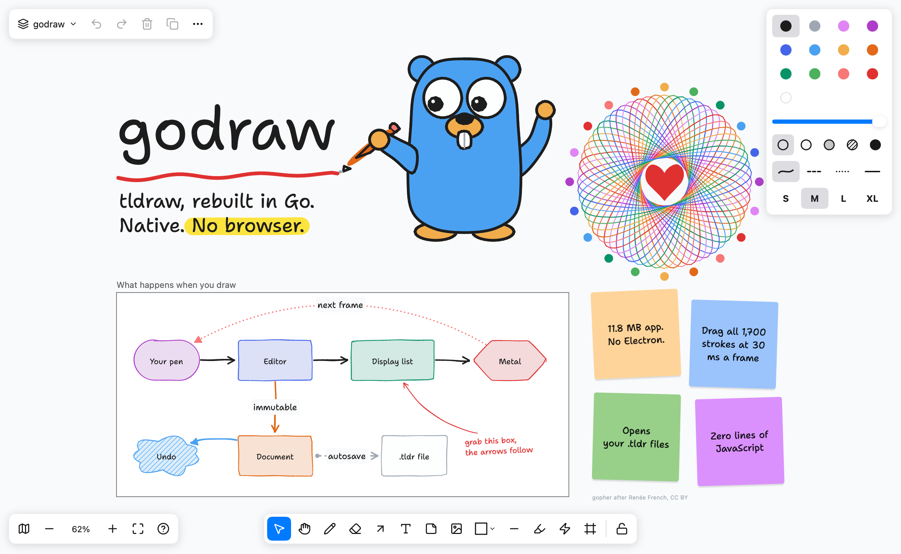

# godraw

A local, native whiteboard in the manner of [tldraw](https://github.com/tldraw/tldraw),
written in Go and drawn with [MyGo](https://github.com/egoist/mygo)'s native UI: no web
view, no JavaScript. It reads and writes tldraw's `.tldr` files.

godraw is an independent reimplementation. It contains no tldraw code and isn't
affiliated with tldraw, Inc.



## Why godraw

Most whiteboard apps are a browser engine with a whiteboard inside. godraw is a single
static binary that draws with the GPU directly. It starts instantly, and your drawings
are plain files on your own disk — no account, no cloud, works fully offline.

## Getting started

Install from a release, no root needed:

```sh
curl -fsSL https://raw.githubusercontent.com/VJ-2303/godraw/main/install.sh | sh
```

Or grab a tarball, `.deb` or `PKGBUILD` from
[Releases](https://github.com/VJ-2303/godraw/releases). Uninstall with
`install.sh --uninstall`.

To build from source, requires [Go](https://go.dev) 1.27 or newer on Linux.

```sh
go run .                    # a new drawing
go run . drawing.tldr       # open a file
go tool mygo build          # package build/linux/godraw
go test ./...
```

Drawings live in `~/Documents/godraw`. The home screen lists them: search, rename,
delete, or start a new one.

## What it does

**Tools.** Select, hand, draw, eraser, arrow, text, note, image, line, highlighter, laser,
frame, and 20 geo shapes. Keep a tool selected with `Q`. Press `?` for every shortcut.

**Editing.** Multiple selection and brush selection, move, resize, rotate, flip, duplicate,
alt-drag to copy, snapping (hold `Ctrl`), grid, group and ungroup, lock, reorder, align and
distribute, copy and paste, undo and redo, and multiple pages.

**Shapes.**
- Hand-drawn, dashed, dotted and solid strokes
- None, semi, solid, pattern and full fills
- Four sizes and four fonts
- Opacity
- Labels on shapes, notes and arrows
- Arrows that bind to shapes and follow them, bend, or route as elbows, with eight arrowheads
- Lines with draggable vertices and curves
- Frames that clip and hold their contents

**Documents.** Each drawing opens in its own window. Autosave and crash recovery are built
in, recent files are one click away, and godraw picks up changes other apps make to a file
you have open.

**Import and export.** Paste images from the clipboard, drop files onto the window, and
export the selection or the whole page as PNG (at 2× resolution) or SVG.

**View.** Pan, zoom and pinch, zoom to fit, minimap, dark mode, focus mode.

## Performance

godraw stays fast by doing less work, not by caching harder:

- **No browser engine.** The UI is drawn by native GPU rendering through MyGo. There is no
  DOM, no JavaScript, and no web view process — startup is immediate and memory use stays
  low.
- **Culling.** Each frame computes a culling box per shape from cached page bounds, and
  only shapes that intersect the viewport are drawn. Zoomed into a corner of a huge board,
  everything off screen costs nothing.
- **Cached display lists.** Each shape's display list is built once and reused across
  moves and zooms.
- **Cheap ordering.** Shapes and pages are ordered by fractional indices — the same scheme
  `.tldr` files use — so reordering never renumbers anything, and undo holds the records
  themselves.
- **Tiled export.** PNG export renders large pages in tiles with per-tile mask atlases and
  stitches them, so pages far larger than the screen or a single GPU texture still export,
  capped at 8192 px per side.

## Compatibility with tldraw

Files are written at the versions of `@tldraw/tlschema` 5.6.0, and tldraw migrates them as
it opens them. Against that package's validators, the app's output passes for every record
type it writes, and the test fixture `internal/doc/testdata/tldraw.tldr` was made with
tldraw's own encoder.

What the app doesn't model is kept and written back: shapes of unknown types (embeds,
bookmarks and video show as labeled boxes), record `meta`, and rich text you haven't edited.

Known differences:

- Rich text shows as plain text. Bold, lists and so on survive until you edit that text,
  which then saves as plain paragraphs.
- Clipboard data is godraw's own, so shapes don't paste across to tldraw. Use `.tldr` files
  to move drawings between the two.
- Hand-drawn strokes and arrow routing are drawn by this app's own algorithms, so they are
  similar to tldraw's, not identical. The colors and sizes are tldraw's.
- SVG export names its fonts instead of embedding them.
- Not implemented: cropping images, note "clone" handles, video playback, multiplayer.

## Layout

| Path | What it is |
| --- | --- |
| `main.go` | Documents, menus and the window |
| `internal/geo` | Vectors, matrices, paths, hit tests; no dependencies |
| `internal/doc` | Records, fractional indices, and the `.tldr` format |
| `internal/editor` | Camera, selection, tools and gestures, undo, and what each shape draws; no UI dependency, so it is tested without a window |
| `internal/app` | The native UI: canvas painter, panels, keyboard, export |
| `internal/assets` | Embedded font and icons |
| `e2e.go` | With `-tags e2e`, lets another process drive the app over MyGo's automation socket |

Committed records are immutable: an edit replaces a record. So undo holds the records
themselves, a snapshot for saving is a copy of the maps, and undoing back to what the file
has leaves the document unedited. Each shape's display list is cached on its record and
reused across moves and zooms.

## Credits

- [Shantell Sans](https://github.com/arrowtype/shantell-sans), the handwriting font (SIL OFL)
- [Lucide](https://lucide.dev), the icons (ISC)

Licenses are in `internal/assets`.
